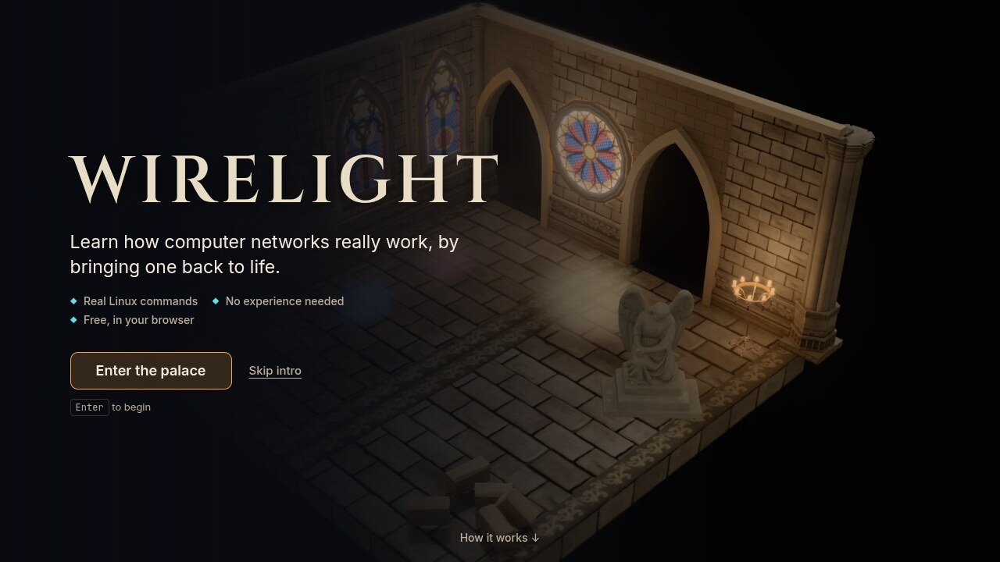
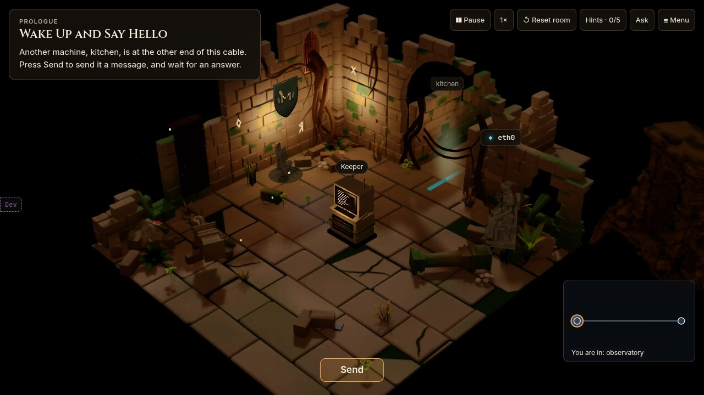
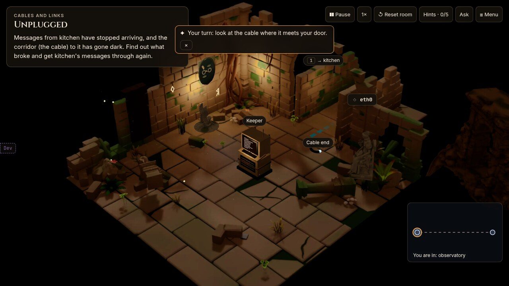
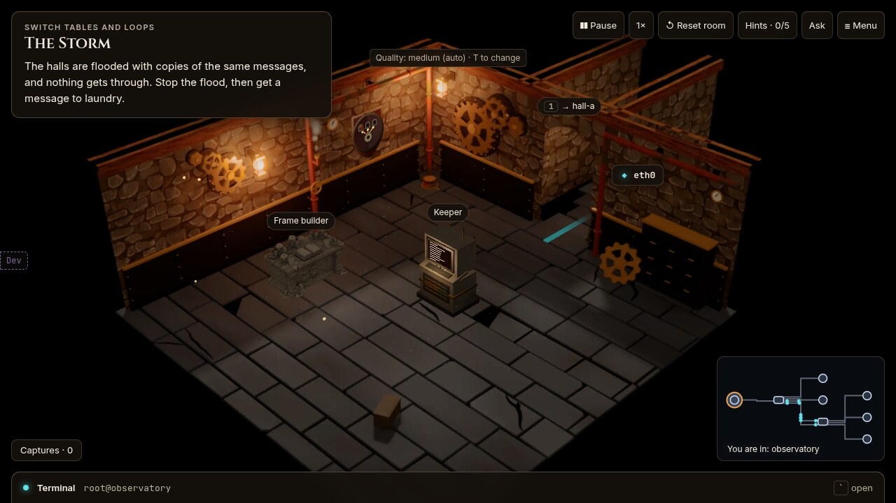
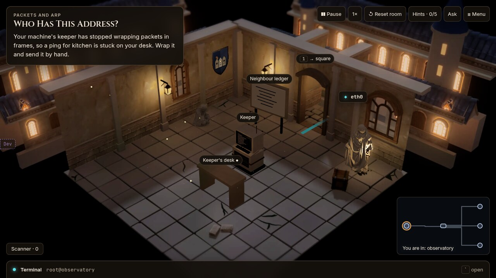
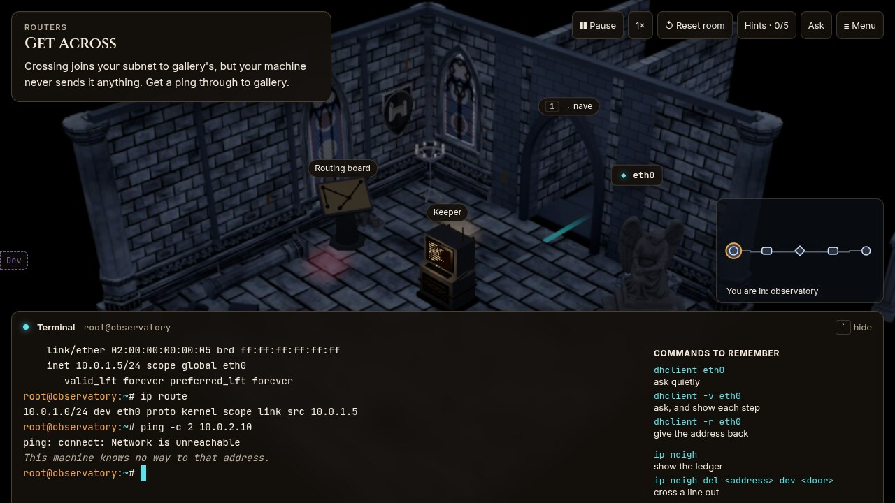
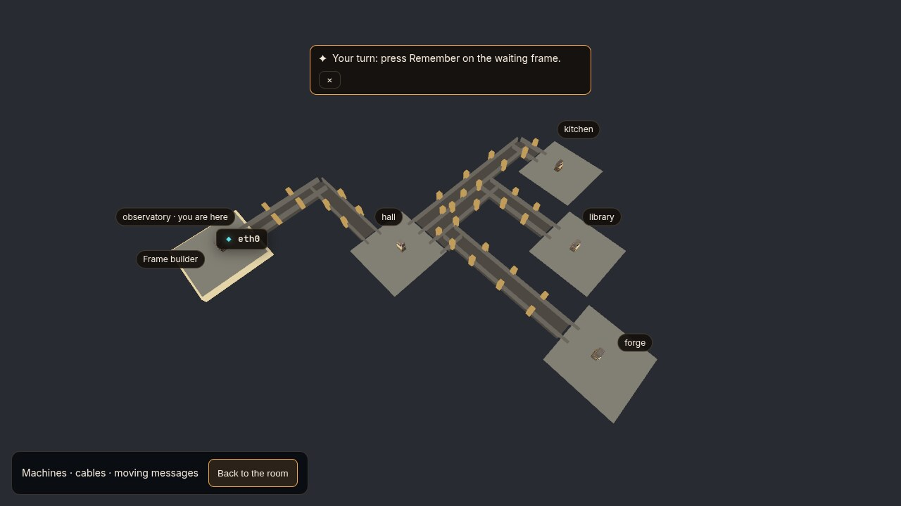

# Wirelight

**A free browser game that teaches how computer networks really work, for complete beginners.**

[**▶ Play it in your browser**](https://wirelight.alsoankit.workers.dev/) · No install, no account, no experience needed.



You are a repair robot. You switch back on in an old palace whose machines stopped passing messages years ago, and your job is to get them talking again, one room at a time. In the palace, **every room is a machine, every door is a network interface, and every corridor is a cable.** You fix what's broken with the same commands people use on real Linux machines, and you watch every message travel as a small light along the cables.

## Screenshots

| | |
|---|---|
|  |  |
| **Prologue.** Your first room: one cable, one machine at the other end. Press Send and wait for an answer. | **Cables and Links.** Messages have stopped arriving. Find out what broke and get them through again. |
|  |  |
| **Switch Tables and Loops.** The halls are flooded with copies of the same message. Stop the flood. | **Packets and ARP.** Do ARP's job by hand: find who has an address and wrap the packet yourself. |
|  |  |
| **Routers.** Real commands, real output: `ping` says *Network is unreachable* until you add the route. | **The map.** See the whole network from above: machines, cables and the messages moving between them. |

## What you learn

Version 1 has **four regions, ten floors and 40 rooms**, plus a secret room in each region. It takes you from a single cable between two machines to routing across several networks.

| Region | Topic | Floors |
|---|---|---|
| **1 · The Overgrown Halls** | cables, network interfaces and MAC addresses | Prologue · Cables and Links · Frames and MAC Addresses |
| **2 · The Sorting Works** | switches | Switches · Switch Tables and Loops |
| **3 · The Lantern Town** | IP addresses, subnets and DHCP | IP Addresses · Packets and ARP · Subnets and DHCP |
| **4 · The Cathedral of Crossings** | routers and routing | Routers · Routing Across Networks |

Along the way you meet links, broadcast, the switch's MAC table, loops and spanning tree, `ping`, packets and frames, ARP, subnets, DHCP, routes, the return path, TTL and routing loops.

## How a room plays

1. **Read the mission:** what's wrong, and what to achieve.
2. **Look around.** Each room has a keeper, the machine that handles its messages. Press **Ask** and its log tells you exactly what it did and why.
3. **Act** by clicking things in the room, or by typing in the terminal once you've switched it on. Every click runs a real command, and the terminal shows it.
4. **Watch the messages move.** Pause or slow down time, catch a copy of a message and open it layer by layer, and replay a lost message's journey on the map.
5. **Win, then read the debrief.** It says what happened and gives the real names for what you just did.

Stuck? Each room has up to five **hints**, from a gentle nudge to the full answer. Mistakes cost nothing: the room shows what went wrong and explains it. The **Learned** page keeps every idea you've met, and each floor ends with a short recap.

## What makes it different

- **One idea at a time.** One new idea per room, at most two new words, and nothing used before it's taught. Harder ideas get more rooms, not busier ones.
- **Plain words first, real terms after.** A room explains an idea in everyday words, and its debrief names the real term. The commands you've learned stay beside the terminal until you know them.
- **You do the network's job.** You plug cables, address messages and sort them by hand before a machine does it for you. No lives, timers, points or leaderboards.
- **Real tools, real output.** `ip`, `ping`, `bridge`, `tcpdump`, `dhclient` and `sysctl` behave like they do on Linux, checked against output captured from real Linux machines. Game-only helpers start with `lab` and say so.
- **You see the invisible.** One event trace from the simulator drives everything on screen, so every message you see really happened, and every machine can explain its choices.
- **For everyone.** It runs in any modern browser, never needs a server to be finished, saves your progress on your device, and has reduced motion and a text-only mode.

## How it's built

| Part | What it does |
|---|---|
| `packages/sim` | A deterministic network simulator: links, bridges, ARP, IPv4, routing and spanning tree, faithful to Linux, with a seeded virtual clock (no randomness, no wall-clock time). |
| `packages/shell` | The command line: `ip link/addr/route/neigh`, `ping`, `bridge`, `tcpdump`, `dhclient`, `sysctl` and `lab …`, with output matching real Linux. |
| `packages/rooms` | Every room as data: its network, what counts as a win, its hints, and a validator that checks every room against the room rules. |
| `packages/engine` | Runs the simulator in a Web Worker and turns its event trace into what the game shows. |
| `packages/content` | All player-facing text in plain English, kept out of the code. |
| `apps/web` | The game: React, React Three Fiber on three.js (WebGPU with a WebGL2 fallback), Zustand, xterm.js and Vite. |
| `supabase/` | The table and access rules for optional, opt-in play logs. |
| `tools/` | Golden-output capture from real Linux, a difference test against real Linux network namespaces, the Blender light bake, the 3D model rework, room screenshots and browser play-throughs. |

**Tested against real Linux.** Every supported command form has golden tests captured from a real Linux machine. More than 1,600 unit and golden tests, the room validator and a browser end-to-end test run on every push in GitHub Actions. Where the simulator differs from Linux on purpose, [`docs/sim-deviations.md`](docs/sim-deviations.md) says how and why.

**The look.** The rooms are built from 3D art kits and museum scans, reworked in Blender (simplified, with fine detail baked into textures, recoloured per region) and lit with light baked in Blender, so they look rich but run on ordinary laptops.

## Running it locally

You need Node 24 or newer and pnpm.

```
pnpm install
pnpm dev               # the game at http://localhost:5173
pnpm test              # simulator, shell, rooms, engine and web tests
pnpm check             # Biome and type checks
pnpm rooms:validate    # every room against the room rules
pnpm build             # production build
pnpm e2e               # browser test of a first visit
```

<details>
<summary><b>Developer aids</b></summary>

- `/play?room=<id>&onboarded=1` opens a room directly, and **Shift+D** opens the dev panel: jump to any room, auto-play it, or try mistakes.
- **Watch the game play itself**, room after room: start it from the dev panel, or open a link such as
  `http://localhost:5173/play?room=prologue&autoplay=1&until=game&speed=1&pace=1`.
  `until` is `floor`, `region` or `game`; `speed` is `1`, `4` or `16`; `pace` (reading time) is `0.6`, `1` or `1.6`. **Shift+N** writes a note about what's on screen, and the notes download as Markdown, grouped by room.
- **Play-through checks:** `node tools/shots/play/region1.mjs http://localhost:5173/play` (and `region2` to `region4`) plays every room of a region in Chrome, as a player would, and reports each win. Set `CHROME` to a Chrome binary to play on the GPU; without it, Playwright's own Chromium plays, drawing in software.
- **Optional sign-in and play logs:** players can sign in from Settings with an email link and choose to send their play logs (off unless they switch it on). To build that in, copy `.env.example` to `.env` and fill in the Supabase project's public key; the table and its rules are in `supabase/migrations/0001_play_logs.sql`. Without a `.env` the game builds and plays exactly the same and sends nothing anywhere.

</details>

## Status and what's next

**Version 1 is playable from start to finish:** all 40 rooms and the four secret rooms, with baked light, music, ambient sound and sound effects.

Next:
- **Playtests with real beginners**, to find where people get stuck.
- **Its own domain name**, and the code open to everyone under the MIT licence.
- **Voices** for the robot's lines. Every line is already written and shown as text.
- **More regions**, climbing to the top of the palace: many routers and finding the path (`traceroute`), ports and connections, names (DNS) and the web, and the edges of the network (NAT and firewalls).

## Assets and credits

Only assets that allow commercial use and redistribution are used: CC0, CC BY, MIT, Apache-2.0 or OFL. Nothing share-alike or non-commercial. Every asset is credited, with links, in [`CREDITS.md`](CREDITS.md).

- **3D art:** Quaternius' modular ruins, nature, village, props and turret packs, and SigilsVault's Modular Cathedral Kit (all CC0), restyled per region; statues and decoration from museum and artist scans (CC0 and CC BY).
- **Sound:** Kenney's audio packs (CC0); other effects and ambience made for Wirelight with FFmpeg.
- **Music:** ethereal ambient tracks by Tsorthan Grove (CC BY 4.0) and an ending by Eliot Corley (CC BY 3.0), from OpenGameArt.
- **Fonts:** Inter, JetBrains Mono and Cinzel (SIL Open Font License).
- **Libraries:** React, three.js, React Three Fiber, drei, Zustand, xterm.js, Comlink, Vite, Biome, Vitest, Playwright and others, each under its own MIT or Apache-2.0 licence.

## Contributing

Bug reports and ideas are welcome as issues. If you'd like to send a change, open an issue first so we can agree on it; every pull request must pass `pnpm check`, `pnpm test` and `pnpm rooms:validate`. Room text follows the game's rules: plain modern English, one new idea per room, and nothing used before it's taught.

## Licence

Wirelight's own code, text, tools and the art and sounds made for it are released under the [MIT License](LICENSE), © 2026 Ankit Kumar.

Third-party assets (3D models, textures, sound packs, fonts, icons and music) are **not** covered by that licence: each keeps its own (CC0, CC BY, the Quaternius Asset License or OFL), listed with links in [`CREDITS.md`](CREDITS.md), with records in `assets-src/licenses/`. If you reuse them, get them from their authors and keep their credits.
